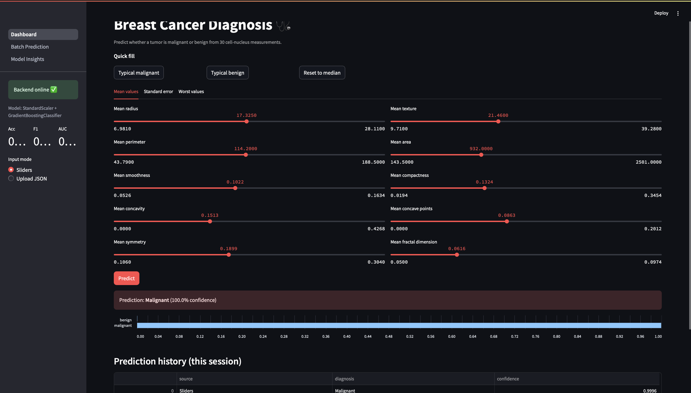
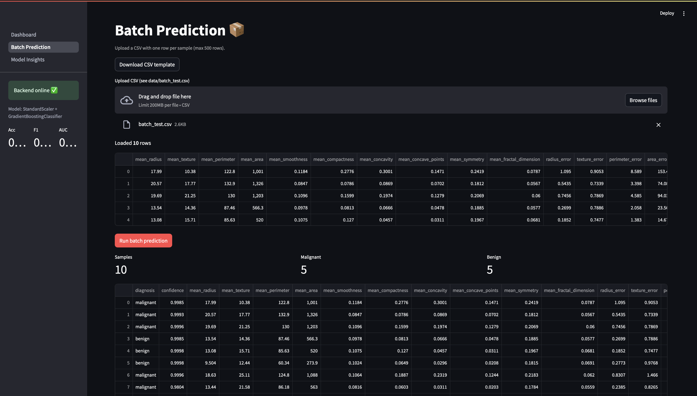
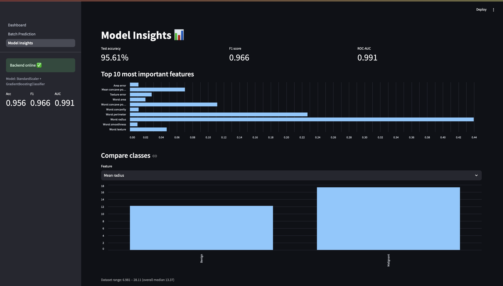

# Breast Cancer Diagnosis Dashboard (Streamlit Lab)

An interactive **Streamlit** dashboard for a breast cancer classification model served by a **FastAPI** backend. Users can enter 30 tumor measurements with sliders or a JSON file, score whole CSV files in one go, and explore model metrics, all from the browser.

Built for the MLOps course (Dr. Ramin Mohammadi, Northeastern University), based on the course's [Streamlit lab](https://github.com/raminmohammadi/MLOps/tree/main/Labs/API_Labs/Streamlit_Labs).

---

## Table of Contents
- [Changes from the Original Lab](#changes-from-the-original-lab)
- [Architecture](#architecture)
- [Project Structure](#project-structure)
- [Prerequisites](#prerequisites)
- [Setup](#setup)
- [Running the Lab](#running-the-lab)
- [Using the Dashboard](#using-the-dashboard)
- [Testing](#testing)
- [Troubleshooting](#troubleshooting)
- [Screenshots](#screenshots)

---

## Changes from the Original Lab

The original lab is a single-page Streamlit app for an Iris model: it checks backend health, accepts a JSON file, and shows the predicted flower name. This version reworks the **Streamlit code itself**:

| # | Change | What it does |
|---|---|---|
| 1 | **Multi-page app** (`pages/`) | Three pages: Dashboard, Batch Prediction, Model Insights, using Streamlit's `pages/` convention. |
| 2 | **Shared sidebar module** (`common.py`) | One `sidebar_status()` function used by every page: backend health check, model-not-trained warning, and live model metrics (`st.metric`). Avoids duplicating code across pages. |
| 3 | **Data-driven sliders** | The 30 sliders are generated from `/model/info` (min/max/median from training data) instead of hard-coded ranges, and grouped into tabs (`st.tabs`) by Mean / Standard error / Worst. |
| 4 | **Two input modes** | Sidebar `st.radio` switches between sliders and JSON upload. The JSON upload validates that all 30 features exist before enabling Predict. |
| 5 | **Preset buttons with `session_state` callbacks** | "Typical malignant / Typical benign / Reset to median" fill all 30 sliders at once through `on_click` callbacks that write to `st.session_state`. |
| 6 | **Richer results** | Red/green result box by diagnosis, confidence %, and a probability bar chart instead of a plain text label. |
| 7 | **Prediction history** | Every prediction in the session is stored in `st.session_state` and shown in a table, with a Clear button. |
| 8 | **Batch Prediction page** | CSV upload → column and row-limit validation → one call to `/predict/batch` → summary metrics, results table, and CSV download. Includes a downloadable CSV template. |
| 9 | **Model Insights page** | Test metrics, top-10 feature importances, and a per-feature malignant-vs-benign comparison chart (`st.selectbox`). |
| 10 | **Caching and error handling** | `@st.cache_data` caches model info for 5 minutes; network errors, 422 validation errors, and other server errors each get a clear message instead of a crash. |
| 11 | **Configurable backend URL** | Backend address comes from the `API_URL` environment variable (default `http://localhost:8000`). |
| 12 | **Automated UI tests** | `tests/test_dashboard.py` uses Streamlit's `AppTest` with a mocked backend to test offline handling, slider rendering, presets, prediction, and both extra pages. |

The backend (`fastapi_app/`) is the breast cancer API from my FastAPI lab, extended so `/model/info` also returns feature ranges, class medians, and feature importances for the dashboard.

---

## Architecture

```
 Browser ──► Streamlit (port 8501) ──HTTP/JSON──► FastAPI (port 8000) ──► model/cancer_model.pkl
              src/Dashboard.py                        GET  /
              src/pages/1_Batch_Prediction.py         GET  /model/info
              src/pages/2_Model_Insights.py           POST /predict
                                                  POST /predict/batch
```

---

## Project Structure

```
cancer-streamlit-lab/
├── assets/                        # README screenshots
├── data/
│   ├── test.json                  # sample input for JSON upload
│   └── batch_test.csv             # 10 samples for batch page
├── src/                           # Streamlit app
│   ├── __init__.py
│   ├── Dashboard.py               # main page
│   ├── common.py                  # shared sidebar + API helpers
│   └── pages/
│       ├── 1_Batch_Prediction.py
│       └── 2_Model_Insights.py
├── fastapi_app/                   # model backend (from FastAPI lab)
│   ├── model/
│   │   ├── cancer_model.pkl       # created by train.py (not tracked in git)
│   │   └── metadata.json          # metrics, feature ranges, class medians
│   └── src/
│       ├── data.py  train.py  predict.py  main.py
├── tests/
│   └── test_dashboard.py          # Streamlit AppTest UI tests
├── requirements.txt               # pinned dependencies
└── README.md
```

---

## Prerequisites

You need **Python 3.11** and **Git**. Nothing else needs to be installed beforehand; all Python packages are installed in step 3 of Setup.

### Python 3.11
- **macOS:** install [Homebrew](https://brew.sh), then run `brew install python@3.11`
- **Windows:** download Python 3.11 from [python.org](https://www.python.org/downloads/) and check **"Add python.exe to PATH"** during install
- **Linux (Ubuntu):** `sudo apt install python3.11 python3.11-venv`

Check the install:
```bash
python3.11 --version      # Windows: py -3.11 --version
```
✅ Expected: `Python 3.11.x`

### Git
- **macOS:** `xcode-select --install` (or `brew install git`)
- **Windows:** download from [git-scm.com](https://git-scm.com/download/win)
- **Linux:** `sudo apt install git`

Check: `git --version` ✅ Expected: `git version 2.x.x`

### Tested with
| Package | Version |
|---|---|
| Python | 3.11 |
| streamlit | 1.39.0 |
| fastapi | 0.115.0 |
| uvicorn | 0.30.6 |
| scikit-learn | 1.5.2 |
| pandas | 2.2.3 |

The full pinned list is in `requirements.txt`.

---

## Setup

```bash
# 1. Clone the repository
git clone https://github.com/kushpatel02/cancer-streamlit-lab.git
cd cancer-streamlit-lab

# 2. Create and activate a virtual environment
python3.11 -m venv streamlitenv
source streamlitenv/bin/activate          # Windows: streamlitenv\Scripts\activate

# 3. Install dependencies
pip install --upgrade pip
pip install -r requirements.txt
```
✅ Expected: your prompt starts with `(streamlitenv)` and pip ends with `Successfully installed ...`

---

## Running the Lab

You need **two terminals**, both with the virtual environment activated and starting from the repository root.

### Terminal 1: train the model and start the backend
```bash
cd fastapi_app/src
python train.py
```
✅ Expected:
```
Model saved | {'accuracy': 0.9561, 'f1': 0.966, 'roc_auc': 0.9911}
```
```bash
uvicorn main:app --reload
```
✅ Expected:
```
INFO:     Uvicorn running on http://127.0.0.1:8000 (Press CTRL+C to quit)
INFO:     Application startup complete.
```
Optional check: open http://localhost:8000/docs to see the API docs.

### Terminal 2: start the dashboard
```bash
source streamlitenv/bin/activate          # Windows: streamlitenv\Scripts\activate
cd src
streamlit run Dashboard.py
```
✅ Expected:
```
You can now view your Streamlit app in your browser.
Local URL: http://localhost:8501
```
The browser opens automatically. The sidebar should show **"Backend online ✅"** and the model's Acc/F1/AUC.

---

## Using the Dashboard

**Dashboard (single prediction)**
1. Leave the sidebar on **Sliders**, then click **Typical malignant**. All 30 sliders jump to malignant-class medians.
2. Click **Predict**. ✅ Expected: a red box reading *Prediction: **Malignant*** with a confidence %, a probability bar chart, and a new row in the history table.
3. Click **Typical benign**, then **Predict**. ✅ Expected: a green box reading ***Benign***.
4. Switch the sidebar to **Upload JSON**, upload `data/test.json`, and click **Predict**. ✅ Expected: ***Benign***.

**Batch Prediction page**
1. Upload `data/batch_test.csv` and click **Run batch prediction**.
2. ✅ Expected: Samples **10**, Malignant **5**, Benign **5**, a results table, and a **Download results CSV** button.

**Model Insights page**
- ✅ Expected: test metrics, a top-10 feature-importance chart, and a malignant-vs-benign chart for the selected feature.

---

## Testing

From the repository root (no servers need to be running, since the backend is mocked):
```bash
pytest -v
```
✅ Expected:
```
tests/test_dashboard.py::test_backend_offline_shows_error PASSED
tests/test_dashboard.py::test_dashboard_renders_30_sliders PASSED
tests/test_dashboard.py::test_preset_fills_sliders PASSED
tests/test_dashboard.py::test_predict_shows_result_and_history PASSED
tests/test_dashboard.py::test_pages_render[1_Batch_Prediction.py] PASSED
tests/test_dashboard.py::test_pages_render[2_Model_Insights.py] PASSED
======================== 6 passed ========================
```

---

## Troubleshooting

| Problem | Fix |
|---|---|
| `command not found: uvicorn` / `streamlit` | Activate the environment: `source streamlitenv/bin/activate` |
| `Could not import module "main"` | Run uvicorn from inside `fastapi_app/src` |
| Sidebar shows **Backend offline 😱** | Terminal 1 isn't running; start uvicorn |
| Sidebar shows **model not trained ⚠️** | Run `python train.py` in `fastapi_app/src`, then refresh |
| Port already in use | `uvicorn main:app --port 8001` and `API_URL=http://localhost:8001 streamlit run Dashboard.py` |

---

## Screenshots

**Dashboard: single prediction**


**Batch prediction**


**Model insights**

